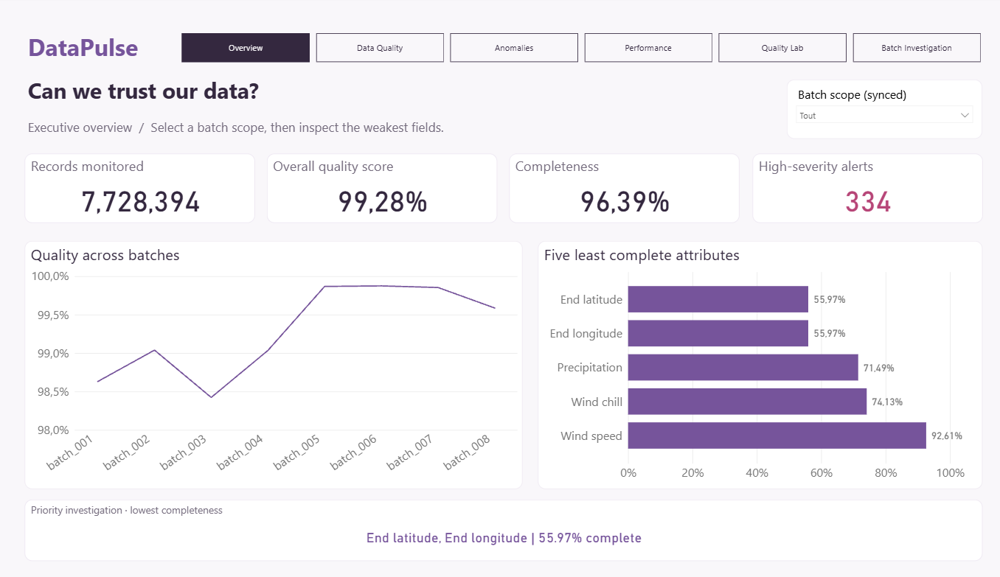
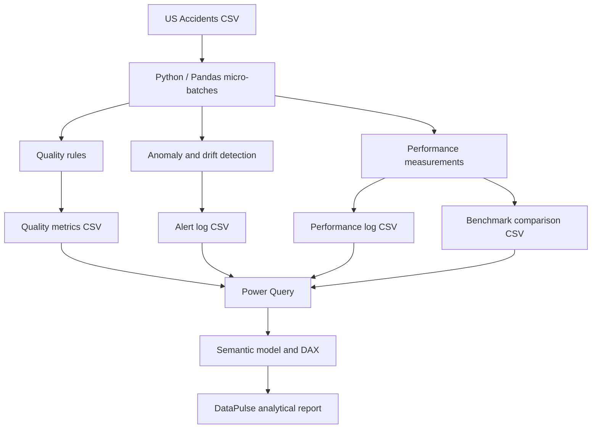
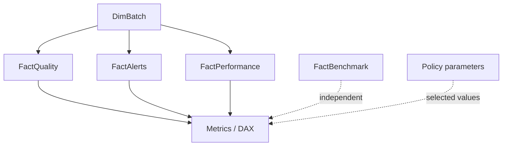
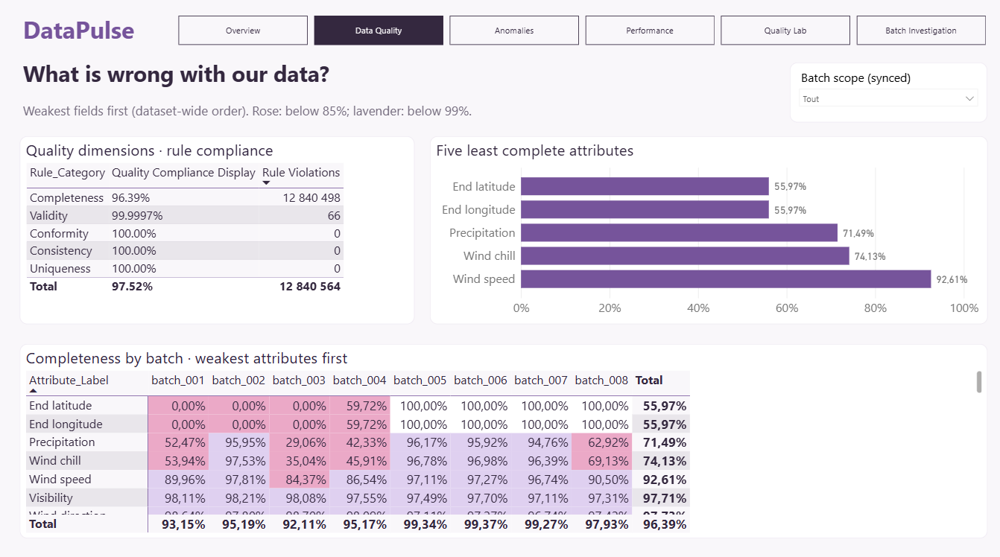
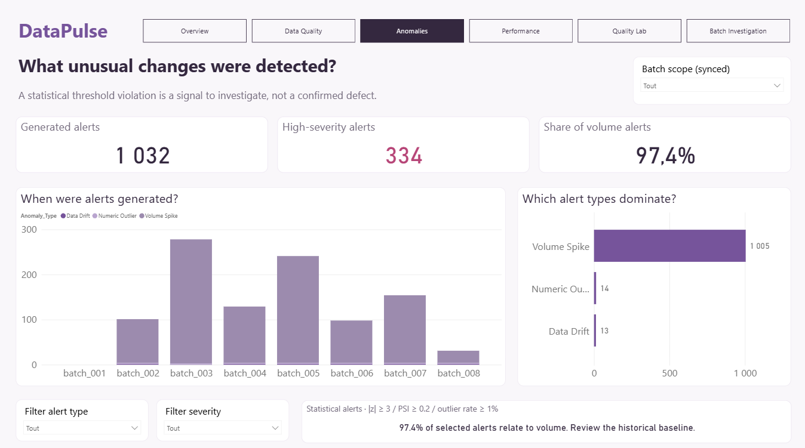
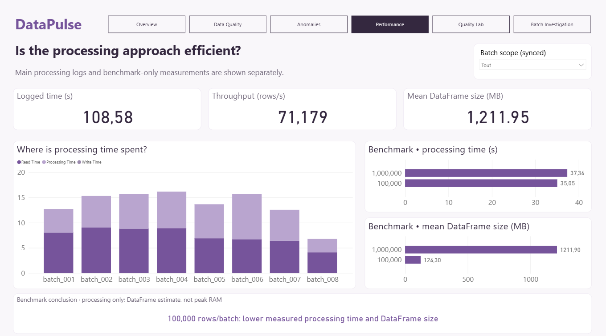
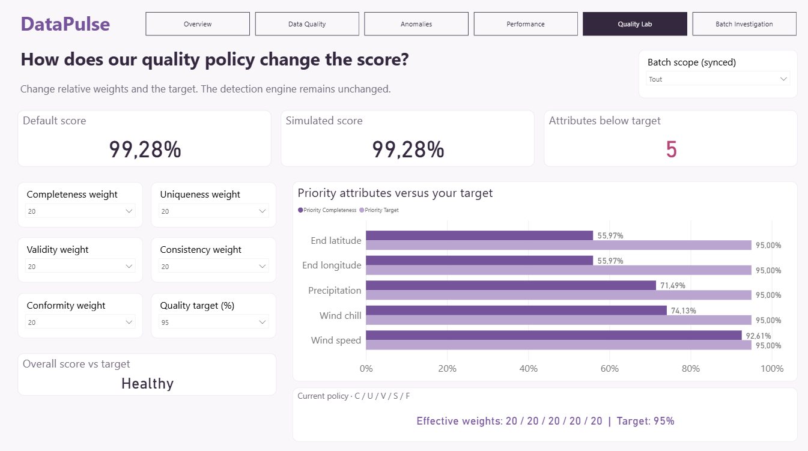
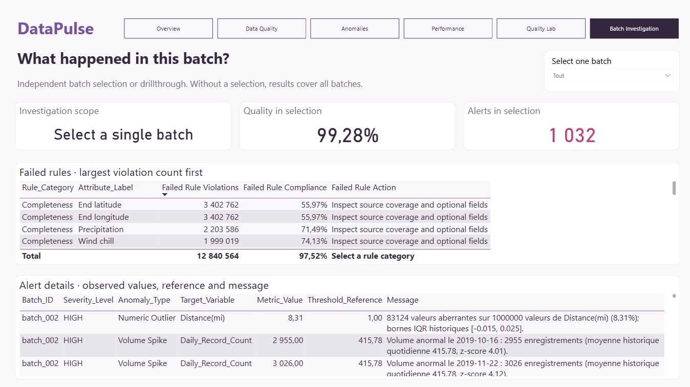

# DataPulse | Intelligent Data Observability

**Big Data Engineering · Data Quality · Business Intelligence**

DataPulse is an interactive Power BI monitoring platform for the **US Accidents (2016–2023)** dataset. It transforms the quality, anomaly and performance metrics produced by the Python processing pipeline into a decision-support interface for data engineers and analysts.

## 1. Vision

A data pipeline should not only process large volumes of information: it should also provide visibility into the reliability of its outputs. Our objective is to make data quality measurable, understandable and actionable.

DataPulse follows a progressive analytical approach: **monitor → identify → investigate → decide**. Rather than displaying every available metric on a single screen, each report page answers a specific question. The interface uses a restrained lavender visual identity, a consistent navigation system and meaningful risk highlights to make technical information easier to interpret.



## 2. How DataPulse works

The solution separates data processing from analytical monitoring. The Python layer reads the source CSV in micro-batches, executes quality rules, detects statistical anomalies and records processing statistics. Power BI imports the resulting monitoring logs instead of loading the original multimillion-row dataset into the report.



| Layer | Role |
|---|---|
| Python / Pandas | Chunk-based processing and statistical controls |
| NumPy | Numerical computations for anomaly and drift detection |
| SQLite | Cross-batch identifier tracking in the main batch processor |
| Power Query (M) | CSV ingestion, typing, readable labels and attribute ordering |
| Semantic model (TMDL) | Tables, relationships and centralized analytical measures |
| DAX | Context-aware KPIs, rankings, simulations and diagnostic messages |
| Power BI (PBIP / PBIR) | Interactive report, navigation, filters and visual analytics |

## 3. Data model

The analytical model contains 12 tables, with a shared batch dimension linking the three main monitoring fact tables. Each table has a different grain (the meaning of a single row).

| Table | Grain / role | Source |
|---|---|---|
| `FactQuality` | One quality rule result per batch and target | `data/quality_metrics.csv` |
| `FactAlerts` | One generated statistical alert | `data/alerts_log.csv` |
| `FactPerformance` | One processing summary per batch | `data/performance_log.csv` |
| `FactBenchmark` | One benchmark configuration | `data/benchmarks/comparison.csv` |
| `DimBatch` | One unique batch identifier | Derived from `FactPerformance` |
| `Metrics` | Central collection of 74 DAX measures | Semantic model |
| Five weight tables + `QualityTarget` | Disconnected policy parameters | Generated with Power Query |



The batch dimension propagates the selected scope across the related facts. The benchmark comparison is kept independent because its batch configurations describe separate processing experiments. Policy tables are also disconnected: their selected values are interpreted by DAX rather than filtering the original observations.

This organization avoids a common analytical error: summing record counts from the quality table, where the same records are counted once for each applicable rule. Record volume is therefore calculated from `FactPerformance`.

## 4. Key performance indicators and DAX

DAX (Data Analysis Expressions) is the calculation layer of the report. Unlike a static column containing a precomputed result, a measure is evaluated in the current filter context. For example, selecting a batch changes the records, quality scores and alerts associated with that selection.

### 4.1 Data volume and rule compliance

```dax
Total Records = SUM(FactPerformance[Record_Count])

Rule Violations = SUM(FactQuality[Error_Count])

Rule Opportunities = SUM(FactQuality[Total_Record_Count])

Compliance Rate =
    IF(
        [Rule Opportunities] > 0,
        1 - DIVIDE([Rule Violations], [Rule Opportunities]),
        BLANK()
    )
```

The compliance rate is the proportion of successful rule checks. Aggregating the numerator and denominator gives larger batches the appropriate influence instead of averaging batch percentages equally. `DIVIDE` and `BLANK()` handle situations where a valid denominator is unavailable.

### 4.2 Five quality dimensions

| Dimension | What it measures |
|---|---|
| Completeness | Presence of expected values |
| Uniqueness | Duplicate accident identifiers |
| Validity | Compliance with allowed values and ranges |
| Consistency | Logical agreement between fields, such as chronological order |
| Conformity | Parseable dates and numeric formats |

Each dimension uses the same compliance measure with a category-specific filter. For example:

```dax
Completeness Score =
    CALCULATE(
        [Compliance Rate],
        FactQuality[Rule_Category] = "Completeness"
    )
```

`CALCULATE` evaluates the measure in a modified filter context while retaining the relevant batch scope. The remaining dimensions follow the same pattern.

### 4.3 Global quality score

The global score assigns equal importance to the five dimensions by default:

**Q = (Completeness + Uniqueness + Validity + Consistency + Conformity) / 5**

```dax
Global Quality Score =
    VAR C = [Completeness Score]
    VAR U = [Uniqueness Score]
    VAR V = [Validity Score]
    VAR S = [Consistency Score]
    VAR F = [Conformity Score]
    RETURN
        IF(
            ISBLANK(C) || ISBLANK(U) || ISBLANK(V) ||
            ISBLANK(S) || ISBLANK(F),
            BLANK(),
            DIVIDE(C + U + V + S + F, 5)
        )
```

We selected equal dimension weights so that completeness, which has many more individual rules, does not automatically dominate the global score. The global score and the aggregate rule compliance rate are intentionally different indicators: the former averages dimensions, while the latter weights every rule opportunity equally.

### 4.4 Alerts and processing performance

```dax
Total Alerts = COALESCE(COUNTROWS(FactAlerts), 0)

High Alerts =
    CALCULATE(
        [Total Alerts],
        KEEPFILTERS(FactAlerts[Severity_Level] = "HIGH")
    )

Total Execution Time = SUM(FactPerformance[Execution_Time_Seconds])

Overall Throughput = DIVIDE([Total Records], [Total Execution Time])

Average Memory Estimate = AVERAGE(FactPerformance[Memory_Usage_MB])
```

`COUNTROWS` counts alert events, not distinct affected accidents. `KEEPFILTERS` intersects the HIGH condition with the user's current severity selection. Throughput uses total records divided by total logged duration, rather than a simple average of batch speeds. Memory is an estimate of DataFrame size, not the peak memory of the entire Python process.

The complete measure definitions are available in [Metrics.tmdl](DataPulseV4.SemanticModel/definition/tables/Metrics.tmdl) and the [DAX reference](../docs/dax-measures.md).

## 5. Analytical report

### Overview — Can we trust our data?

Four headline KPIs summarize record volume, overall quality, completeness and high-severity alerts. The trend reveals differences across batches, while the weakest-attribute chart and dynamic finding direct attention toward the fields requiring investigation.

### Data Quality — What is wrong with our data?



The five-dimensional compliance table separates quality categories. The completeness heatmap reveals whether missing values are persistent or concentrated in particular batches. Attributes are ordered by dataset-wide missingness, while the priority chart responds to the selected batch scope.

The heatmap is driven by the `Completeness Cell Color` measure: rose below 85%, lavender from 85% to below 99%, and white from 99% upward. These are reporting thresholds, not universal quality standards.

### Anomalies — What unusual changes were detected?



The report analyzes the distribution of generated alerts by batch, anomaly type and severity. The underlying pipeline applies:

| Method | Detection objective | Trigger |
|---|---|---|
| Z-score | Unusual daily record volumes | Absolute Z-score ≥ 3 |
| Population Stability Index (PSI) | Changes in numerical distributions | PSI ≥ 0.2 |
| Interquartile Range (IQR) | Numerical outliers relative to historical bounds | Outlier rate ≥ 1% |

The report does not rerun these statistical algorithms. It interprets their recorded outputs and highlights patterns such as the predominance of volume alerts. A statistical alert indicates a need for investigation, not necessarily a confirmed data defect.

### Performance — Is the processing approach efficient?



This page separates the main processing log from the benchmark comparison. It presents reading and processing times, throughput, mean DataFrame size and the trade-off between 100,000 and 1,000,000 rows per batch. A DAX finding identifies the configuration with the lowest measured processing time and memory estimate.

### Quality Lab — How does our quality policy change the score?



Quality requirements vary according to operational priorities. The Quality Lab allows the analyst to assign relative weights to the five dimensions and select a target between 80% and 100%.

```dax
Completeness Weight = SELECTEDVALUE(WeightCompleteness[Weight], 20)

Selected Target = DIVIDE(SELECTEDVALUE(QualityTarget[Target], 95), 100)
```

The simulated score is a normalized weighted average:

**Qw = (wC × C + wU × U + wV × V + wS × S + wF × F) / (wC + wU + wV + wS + wF)**

Weights range from 0 to 100 in steps of 5. The default is 20 for each dimension and a target of 95%. If every weight is zero, the simulated score is undefined. With equal weights, the simulated and default scores coincide. The policy status compares the simulated overall score with the selected target, and the attribute-level indicator counts completeness scores below that target.

This is a what-if analysis of the existing measurements. It does not modify the raw data, execute new tests or change the Python detection thresholds.

### Batch Investigation — What happened in this batch?



A dedicated investigation page provides an independent batch selector and drillthrough navigation. Failed quality rules are ordered by violation count, with category-specific investigation guidance. The alert detail table provides the affected variable, observed metric, reference and original message.

For example, a completeness violation suggests checking source coverage and optional fields, while a consistency violation suggests reviewing timestamps or relationships between fields. These recommendations support investigation rather than automatically repairing data.

## 6. Results on the current monitoring logs

The following values correspond to the full batch scope and the default quality policy shown in the report screenshots.

| Indicator | Result |
|---|---:|
| Records monitored | 7,728,394 |
| Batches processed | 8 |
| Global quality score | 99.28% |
| Aggregate rule compliance | 97.52% |
| Completeness | 96.39% |
| Rule violations | 12,840,564 |
| Generated alerts | 1,032 |
| High-severity alerts | 334 |
| Volume-related alerts | 97.4% |
| Total logged execution time | 108.58 s |
| Overall throughput | 71,179 rows/s |
| Average DataFrame size | 1,211.95 MB |

Three findings illustrate why the report is useful:

- **Quality:** a high overall score does not imply every attribute is reliable. End latitude and end longitude are only 55.97% complete, with 0% completeness in the first three batches. Source coverage and optional-field semantics should be investigated before classifying these omissions as defects.
- **Anomalies:** 1,005 of the 1,032 recorded alerts are volume spikes. This concentration motivates a review of the historical baseline and the way records are grouped into batches.
- **Performance:** the 100K configuration recorded 35.05 s of processing time and a 124.3 MB mean DataFrame size, compared with 37.36 s and 1,211.9 MB for the 1M configuration. It is the preferable configuration under these particular measured criteria, not a universal performance conclusion.

The counts of rule violations and alerts must not be interpreted as counts of distinct incorrect accident records. Multiple rules or statistical alerts may concern overlapping observations.

## 7. Running the report

Requirements: Power BI Desktop with support for Power BI Projects, the repository and its four monitoring CSVs. The raw US Accidents dataset is not required to open the report using existing logs.

From the repository root, close Power BI Desktop and run:

```powershell
powershell -ExecutionPolicy Bypass -File .\dashboard\setup.ps1
Invoke-Item .\dashboard\DataPulseV4.pbip
```

The setup script verifies the four CSV files and updates the Power Query source paths to the local repository. Open the project and refresh the data. Select a batch on any of the five main pages to change the monitoring scope, or use the independent investigation page for detailed diagnostics.

## 8. Project organization

```text
big-data-observability/
├── data/                       # Source and monitoring outputs
├── notebooks/                  # Exploratory profiling
├── src/                        # Quality, anomaly and batch processing
├── scripts/                    # Benchmarks and log regeneration
├── dashboard/
│   ├── DataPulseV4.pbip
│   ├── DataPulseV4.Report/      # Editable report definitions (PBIR)
│   ├── DataPulseV4.SemanticModel/ # Semantic model (TMDL)
│   ├── DataPulse.theme.json
│   ├── setup.ps1
│   ├── assets/                 # Report screenshots
│   └── README.md
├── docs/                       # Architecture, DAX and methodology
└── tests/                      # Data and report-structure checks
```

The PBIP format separates the semantic model from report definitions, making model changes and report development traceable through Git.

## 9. Scope and perspectives

The current implementation provides batch-based monitoring from persisted CSV logs. Data refresh is required to reflect new processing results. Quality evolution follows the batch sequence rather than accident-event dates. Detection uses a first-batch historical reference; anomaly accuracy has not been established by a labeled ground-truth experiment. The quality score and policy thresholds are analytical choices. Further work could introduce an explicit historical reference, automated refresh, controlled anomaly tests and record-level diagnostics.

## References

- [Project repository and processing implementation](https://github.com/hajerbgh/big-data-observability)
- [Microsoft Learn — DAX overview](https://learn.microsoft.com/en-us/dax/dax-overview)
- [Microsoft Learn — Star schema and Power BI](https://learn.microsoft.com/en-us/power-bi/guidance/star-schema)
- [Microsoft Learn — Power BI Projects](https://learn.microsoft.com/en-us/power-bi/developer/projects/projects-overview)
- [Microsoft Learn — Drillthrough](https://learn.microsoft.com/en-us/power-bi/create-reports/desktop-drillthrough)
